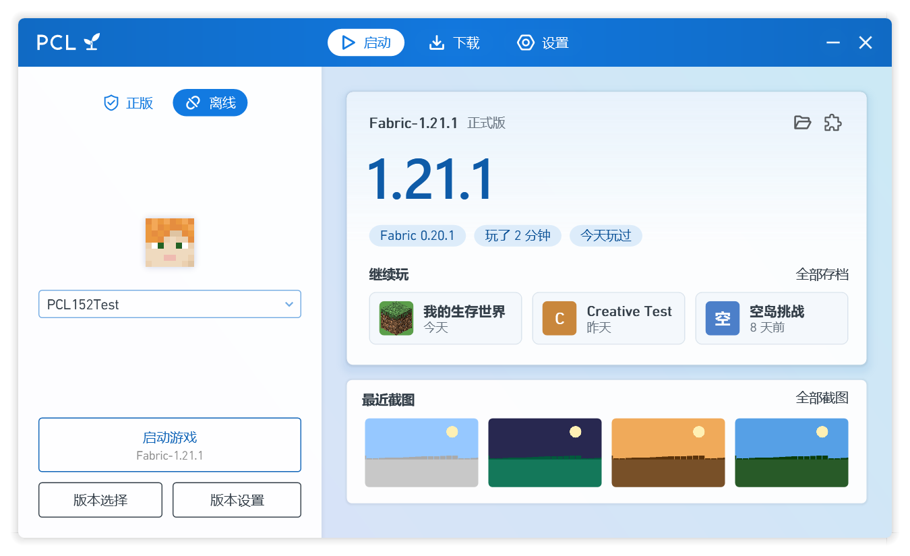

<p align="center"></p>

<h1 align="center">Plain Craft Launcher (PCL) 樹苗修改版</h1>

<p align="center">由 PZW152 基于 <a href="https://github.com/Meloong-Git/PCL">Plain Craft Launcher 2</a> 独立进行二次创作的第三方修改版，<b>并非 PCL 官方版本</b>。</p>

<p align="center">简体中文 · <a href="README.zh-Hant.md">繁體中文</a></p>

---

PCL 是龙腾猫跃开发的 Minecraft Java 版启动器。樹苗修改版保留了 PCL2 的界面语言与使用方式——单个 exe，放进文件夹就能用，不需要安装——并融合了作者另一个启动器 Sapling（樹苗）的功能与界面设计，同时参考了 [PCL CE](https://github.com/PCL-Community/PCL-CE) 与其他主流启动器的做法。

如果你喜欢 PCL，请[赞助 PCL 的原作者龙腾猫跃](https://meloong.com/afd/a/LTCat)。

<p align="center"></p>

## 来自 Sapling 的功能

- **首页主角卡**：当前版本的名字、主题蓝的大号版本号、加载器与游玩时间一眼可见，下方是最近截图
- **继续玩**：首页列出最近的世界和服务器，点一下直接进入（世界需要 Minecraft 1.20 及以上）
- **实时游戏日志**：游戏运行时在首页显示最新的输出，崩溃后也能回看
- **一键开始**：还没有任何版本时，点「开始玩」就会下载最新正式版并直接进入游戏
- **Quilt**：安装 Quilt，安装、导入 Quilt 整合包，修改实例时保留 Quilt
- **截图管理**：在实例中浏览、预览、删除截图（删除时移到回收站）
- **清理游戏文件**：找出没有任何版本在用的资源与支持库，删除前先确认
- **桌面快捷方式**：为实例创建快捷方式，双击直接启动游戏
- **简体与繁体中文**：界面语言切换即时生效，繁体用词照顾港澳台的习惯
- 版本列表按最近游玩排序并显示上次游玩时间；删除世界时移到回收站；`Ctrl + 1/2/3` 切换页面
- 关于页可以一键复制诊断信息、反馈问题、查看第三方许可

## 与 PCL 原版的其他区别

**更快、更稳**

- 整个程序从 VB.NET 改写为 C#，启动流程、下载与网络请求改为异步执行，可以随时取消
- 正常启动时只做快速的文件检查；游戏崩溃后的下一次启动才完整校验
- 网络不可用时，版本列表等内容沿用上一次成功获取的结果，已安装的版本照常启动
- 相同的 Mod 文件在实例之间以硬链接共享，不重复占用空间
- 只使用 Mojang、Forge、Fabric、Quilt、NeoForge、Modrinth、CurseForge 的官方下载源

**更好用**

- 微软登录支持扫描二维码
- 实例概览显示游玩时间，可以一键进入或备份存档
- 从 Prism Launcher、MultiMC 导入实例
- 新游戏的默认设置：语言、视距、音量等
- Mod 管理会检查已启用的 Mod 是否缺少前置；可以固定内存大小（取自 PCL CE）
- 整合包安装前先列出内容，来自 Modrinth 与 GitHub 以外的下载会特别提示
- 游戏退出后，从游戏日志中抹去登录令牌，分享日志更安全
- 导出 / 导入启动器设置；从 GitHub 自动检查更新
- 崩溃分析修正了多处取不到 Mod 名称的问题

**更简洁**

- 移除了背景图片、标题栏自定义、自定义主页与功能隐藏，彩色背景始终开启
- 很少有人调整的设置（不透明度、进程优先级、下载限速、文件名格式、缓存文件夹等）改为固定的推荐值

**外观**

- 深色模式（跟随系统、浅色或深色），三档界面大小，所有按钮都能用键盘操作
- 五种蓝色主题与可在蓝色范围内调整的自定义主题（PCL 的使用指南要求界面主色调为蓝色）
- 新的图标：PCL 蓝底上的樹苗

## 下载

到 [Releases](https://github.com/PZW152/PCL-Sapling/releases) 下载最新版本，放进一个文件夹后直接打开即可。之后启动器会自动检查更新。

需要 Windows 10 或 Windows 11（系统自带的 .NET Framework 4.8）。

## 反馈问题

请在[本仓库的 Issues](https://github.com/PZW152/PCL-Sapling/issues/new/choose) 反馈，并附上「设置 → 关于 → 复制诊断信息」的内容。**不要把本修改版的问题反馈给 PCL 原作者。**

## 从源代码构建

```bash
git clone --recursive https://github.com/PZW152/PCL-Sapling.git
cd PCL-Sapling
dotnet build "Plain Craft Launcher 2/Plain Craft Launcher 2.csproj" -c Release
dotnet run --project PCL.Tests/PCL.Tests.csproj -c Debug
```

微软登录与 CurseForge 需要你自己的密钥：在仓库根目录创建 `BuildSecrets.local.props`（已被 git 忽略），或设置环境变量 `PCL_MS_CLIENT_ID`、`PCL_CURSEFORGE_API_KEY`。

## 许可、署名与隐私

- 本项目基于 PCL 修改，遵循 PCL 的《PCL 分发有限许可》与《PCL 存储库合理使用指南》，见 [LICENCE](LICENCE)。
- PCL 由龙腾猫跃开发，版权归成都瓜皮龙科技有限公司所有。启动器的「关于」页面在首位给出龙腾猫跃的署名与赞助链接。
- 融合的 Sapling 与本修改版是同一作者（PZW152）。Quilt 图标取自 PCL CE（Apache-2.0）。所有第三方组件及其许可见 [THIRD-PARTY-NOTICES.md](THIRD-PARTY-NOTICES.md)。
- 用户协议、免责声明与隐私说明见 [TERMS.md](TERMS.md)。本修改版不收集个人信息。
- 本修改版与 PCL 官方无关。非 Minecraft 官方产品，未经 Mojang 或 Microsoft 批准，也不与 Mojang 或 Microsoft 关联。
