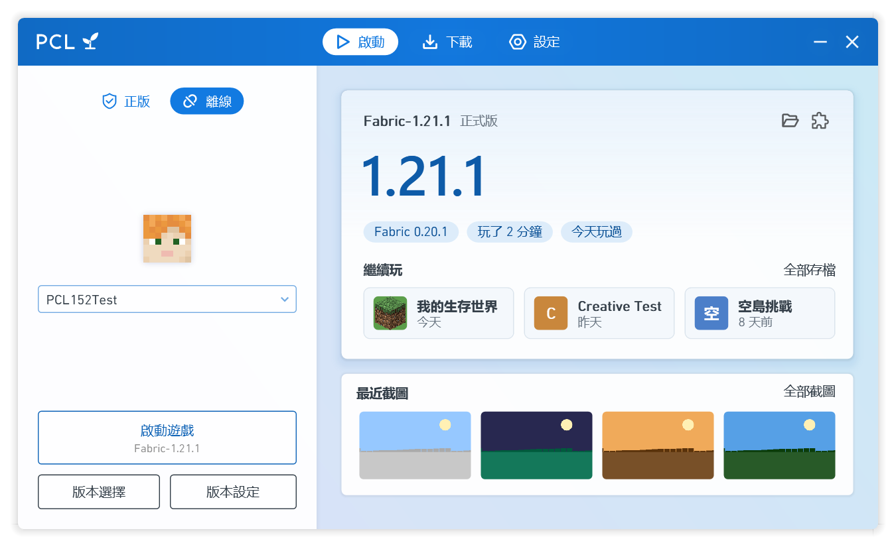

<p align="center"></p>

<h1 align="center">Plain Craft Launcher (PCL) 樹苗修改版</h1>

<p align="center">由 PZW152 基於 <a href="https://github.com/Meloong-Git/PCL">Plain Craft Launcher 2</a> 獨立進行二次創作的第三方修改版，<b>並非 PCL 官方版本</b>。</p>

<p align="center"><a href="README.md">简体中文</a> · 繁體中文</p>

---

PCL 是龍騰貓躍開發的 Minecraft Java 版啟動器。樹苗修改版保留了 PCL2 的介面語言與使用方式——單個 exe，放進資料夾就能用，不需要安裝——並融合了作者另一個啟動器 Sapling（樹苗）的功能與介面設計，同時參考了 [PCL CE](https://github.com/PCL-Community/PCL-CE) 與其他主流啟動器的做法。

如果你喜歡 PCL，請[贊助 PCL 的原作者龍騰貓躍](https://meloong.com/afd/a/LTCat)。

<p align="center"></p>

## 來自 Sapling 的功能

- **首頁主角卡**：當前版本的名字、主題藍的大號版本號、載入器與遊玩時間一眼可見，下方是最近截圖
- **繼續玩**：首頁列出最近的世界和伺服器，點一下直接進入（世界需要 Minecraft 1.20 及以上）
- **即時遊戲日誌**：遊戲運行時在首頁顯示最新的輸出，崩潰後也能回看
- **一鍵開始**：還沒有任何版本時，點「開始玩」就會下載最新正式版並直接進入遊戲
- **Quilt**：安裝 Quilt，安裝、匯入 Quilt 整合包，修改實例時保留 Quilt
- **截圖管理**：在實例中瀏覽、預覽、刪除截圖（刪除時移到回收站）
- **清理遊戲檔案**：找出沒有任何版本在用的資源與支持庫，刪除前先確認
- **桌面捷徑**：為實例建立捷徑，按兩下直接啟動遊戲
- **簡體與繁體中文**：介面語言切換即時生效，繁體用詞照顧港澳臺的習慣
- 版本列表按最近遊玩排序並顯示上次遊玩時間；刪除世界時移到回收站；`Ctrl + 1/2/3` 切換頁面
- 關於頁可以一鍵複製診斷資訊、回報問題、查看第三方許可

## 與 PCL 原版的其他區別

**更快、更穩**

- 整個程式從 VB.NET 改寫為 C#，啟動流程、下載與網絡請求改為異步執行，可以隨時取消
- 正常啟動時只做快速的檔案檢查；遊戲崩潰後的下一次啟動才完整校驗
- 網絡不可用時，版本列表等內容沿用上一次成功獲取的結果，已安裝的版本照常啟動
- 相同的 Mod 檔案在實例之間以硬連結共享，不重複佔用空間
- 只使用 Mojang、Forge、Fabric、Quilt、NeoForge、Modrinth、CurseForge 的官方下載源

**更好用**

- 微軟登入支援掃描 QR 碼
- 實例概覽顯示遊玩時間，可以一鍵進入或備份存檔
- 從 Prism Launcher、MultiMC 匯入實例
- 新遊戲的預設設定：語言、視距、音量等
- Mod 管理會檢查已啟用的 Mod 是否缺少前置；可以固定記憶體大小（取自 PCL CE）
- 整合包安裝前先列出內容，來自 Modrinth 與 GitHub 以外的下載會特別提示
- 遊戲退出後，從遊戲日誌中抹去登入令牌，分享日誌更安全
- 匯出 / 匯入啟動器設定；從 GitHub 自動檢查更新
- 崩潰分析修正了多處取不到 Mod 名稱的問題

**更簡潔**

- 移除了背景圖片、標題欄自訂、自訂主頁與功能隱藏，彩色背景始終開啟
- 很少有人調整的設定（不透明度、進程優先級、下載限速、檔案名格式、緩存資料夾等）改為固定的推薦值

**外觀**

- 深色模式（跟隨系統、淺色或深色），三檔介面大小，所有按鈕都能用鍵盤操作
- 五種藍色主題與可在藍色範圍內調整的自訂主題（PCL 的使用指南要求介面主色調為藍色）
- 新的圖示：PCL 藍底上的樹苗

## 下載

到 [Releases](https://github.com/PZW152/PCL-Sapling/releases) 下載最新版本，放進一個資料夾後直接打開即可。之後啟動器會自動檢查更新。

需要 Windows 10 或 Windows 11（系統自帶的 .NET Framework 4.8）。

## 回報問題

請在[本倉庫的 Issues](https://github.com/PZW152/PCL-Sapling/issues/new/choose) 回報，並附上「設定 → 關於 → 複製診斷資訊」的內容。**不要把本修改版的問題回報給 PCL 原作者。**

## 從源代碼構建

```bash
git clone --recursive https://github.com/PZW152/PCL-Sapling.git
cd PCL-Sapling
dotnet build "Plain Craft Launcher 2/Plain Craft Launcher 2.csproj" -c Release
dotnet run --project PCL.Tests/PCL.Tests.csproj -c Debug
```

微軟登入與 CurseForge 需要你自己的密鑰：在倉庫根目錄建立 `BuildSecrets.local.props`（已被 git 忽略），或設定環境變量 `PCL_MS_CLIENT_ID`、`PCL_CURSEFORGE_API_KEY`。

## 許可、署名與隱私

- 本項目基於 PCL 修改，遵循 PCL 的《PCL 分發有限許可》與《PCL 存儲庫合理使用指南》，見 [LICENCE](LICENCE)。
- PCL 由龍騰貓躍開發，版權歸成都瓜皮龍科技有限公司所有。啟動器的「關於」頁面在首位給出龍騰貓躍的署名與贊助連結。
- 融合的 Sapling 與本修改版是同一作者（PZW152）。Quilt 圖示取自 PCL CE（Apache-2.0）。所有第三方組件及其許可見 [THIRD-PARTY-NOTICES.md](THIRD-PARTY-NOTICES.md)。
- 用戶協議、免責聲明與隱私說明見 [TERMS.md](TERMS.md)。本修改版不收集個人資訊。
- 本修改版與 PCL 官方無關。非 Minecraft 官方產品，未經 Mojang 或 Microsoft 批准，也不與 Mojang 或 Microsoft 關聯。
